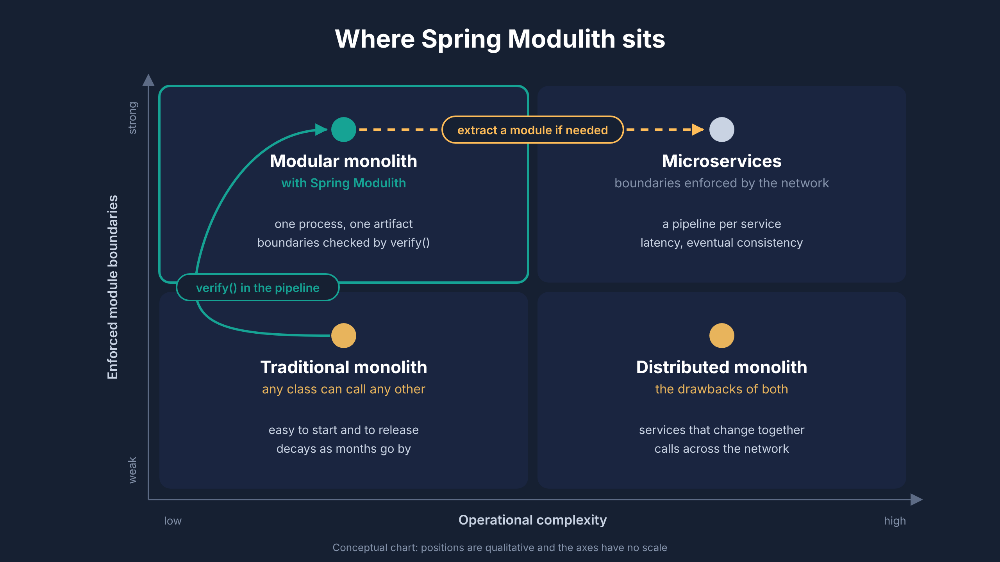

For years the debate about how to structure Spring Boot applications has been reduced to a stark choice between two extremes. On one side sits the traditional monolith, easy to build and release but bound, as the months go by, to turn into a tangle in which any class can call any other, and on the other side sit microservices, which enforce clear boundaries at the price of a network to cross, a pipeline for every service and an entire operational discipline to run. Spring Modulith is the official answer of the Spring project to those looking for something in between, a toolkit that keeps the application in a single process and a single artifact, but organises the code into logical modules inspired by Domain-Driven Design and, above all, checks automatically that those boundaries are respected over time.

##### A middle ground with a long history

The problem with the monolith is not that it runs in a single process, but the structural decay it suffers when nothing prevents one module from depending on the internal details of another. Moving everything into separate services solves that decay by force, because a service cannot import the classes of another one, but it brings latency, eventual consistency and distributed observability even when the domain does not call for them, and in the worst cases it produces a distributed monolith that adds up the drawbacks of both approaches. Oliver Drotbohm, of the Spring team, nurtured this idea for years as a personal research project, which became an experimental Spring project in 2022 and reached version 1.0 as an official project on 21 August 2023. Version 2.0, released in November 2025, moved the baseline to Spring Boot 4 and Spring Framework 7, while 2.1 followed in June 2026.

<figure>
  
  <figcaption>Spring Modulith aims for the quadrant with strong boundaries and still low operational complexity</figcaption>
</figure>

##### Modules are packages

The most interesting choice in Spring Modulith is the near absence of configuration, because by default every direct sub-package of the application's main package is treated as a module. The public types at the root of the module form its interface, while everything in its sub-packages is considered internal, even when Java forces a class to be public so that another class in the same module can use it.

```text
com.example.shop
├── ShopApplication.java
├── order
│   ├── OrderManagement.java      // public API of the module
│   ├── OrderCompleted.java       // event published by the module
│   └── internal
│       └── OrderRepository.java  // hidden from other modules
└── inventory
    ├── InventoryManagement.java
    └── internal
        └── StockLevels.java
```

When a module needs to expose more than one package, for example an extension interface meant for other modules, it is enough to annotate the corresponding `package-info.java` with `@NamedInterface`, while `@ApplicationModule(allowedDependencies = …)` makes it possible to declare explicitly which modules another one may depend on. The result is that the architecture stops living in a forgotten diagram on a wiki and becomes a property of the code structure, readable by anyone who opens the project.

##### Boundaries verified, not just declared

A convention holds only as long as someone enforces it, and this is where Spring Modulith offers its most useful tool, a test of a few lines that builds the module model from the main class and checks it.

```java
class ModularityTests {

    @Test
    void verifiesModularStructure() {
        ApplicationModules.of(ShopApplication.class).verify();
    }
}
```

The `verify()` method fails if the dependencies between modules form a cycle, if a module accesses the internal types of another one or if the explicitly declared allowed dependencies are violated, and when it finds the jMolecules integration for ArchUnit on the classpath it applies the corresponding architectural rules as well. Added to the continuous integration pipeline, it turns every boundary violation into a red build rather than a surprise discovered months later during a refactoring. Since version 2.0 the same verification can also run at application startup, by adding the `spring-modulith-runtime` artifact and enabling the `spring.modulith.runtime.verification-enabled` property.

##### Events instead of direct calls

Even with the boundaries respected, a module that directly invokes the services of five others remains tightly coupled, which is why Spring Modulith suggests integrating modules through Spring application events. The `@ApplicationModuleListener` annotation is a shortcut that combines a transactional listener running after commit with asynchronous execution and a dedicated new transaction.

```java
@Component
class InventoryManagement {

    @ApplicationModuleListener
    void on(OrderCompleted event) {
        // update stock levels in a separate transaction
    }
}
```

The risk of this model is losing an event if the application stops between the commit of the order and the execution of the listener, and this is where the Event Publication Registry comes in. At publication time the registry writes an entry for every interested listener within the same business transaction, marks it as completed when the listener finishes successfully and keeps it otherwise, so that it can be resubmitted on the next startup, if the dedicated property is enabled, or from code. Since 2.0 every publication has an explicit lifecycle, with states such as processing, failed and resubmitted, and an optional monitor marks publications stuck for too long as failed, so they can then be resubmitted through `FailedEventPublications`. The registry can be stored with JDBC, JPA, MongoDB or Neo4j.

<figure>
  
  <figcaption>The event is stored in the same transaction as the order, so it cannot be lost if the listener fails</figcaption>
</figure>

##### Per-module tests and documentation that does not go stale

With the `@ApplicationModuleTest` annotation an integration test bootstraps only the module it lives in, in the default `STANDALONE` mode, or also its direct dependencies or the whole dependency tree, which shortens startup times and makes it obvious when a module needs too many others to work. The `Scenario` API then lets you describe event-based tests as a stimulus followed by an expected outcome, for example the publication of an event followed by a change in the state of another module. The same model feeds the `Documenter`, which generates C4 and UML component diagrams with PlantUML and an Application Module Canvas, a table listing the beans, aggregates, published and consumed events and configuration properties of each module, which stays in line with the code because it is regenerated on every build.

##### When it really pays off

Spring Modulith does not offer the runtime isolation of microservices, because modules share the same JVM, the same classpath and often the same database, so an out of memory error in one module stops the whole application and scalability remains that of the entire process. In return it offers something that matters more for most projects, the possibility of postponing the decision about distribution until the domain has really been understood. A module with verified boundaries that talks to the others only through events is already the ideal candidate to become a separate service, and extracting it becomes an infrastructure job rather than an archaeological dig through the code. For a new Spring Boot project, at this point, the question is no longer whether to start with a monolith or with microservices, but whether there is a good reason not to start with a modular monolith.
