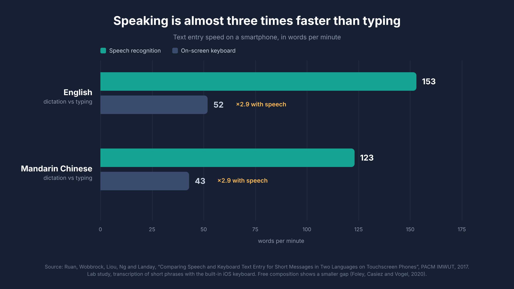
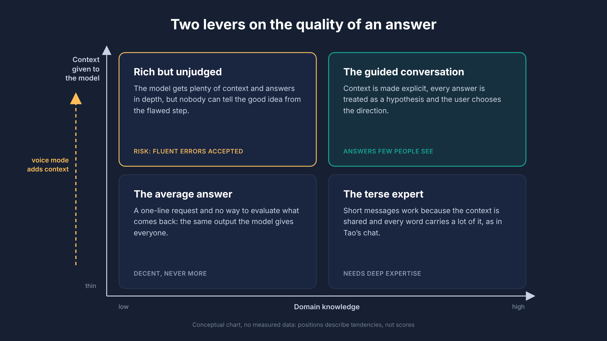

Those who don't know the craft get from artificial intelligence exactly what everyone else gets. Until a few years ago, someone who couldn't write the code for a web page would ask a colleague for help, while today they ask a model and something decent comes out almost every time, and from this experience comes a very widespread idea, namely that there is no skill in prompting, because we are all talking to the same machine and a professional would get the same result as someone who opened ChatGPT for the first time this morning. It is a comfortable idea, but it does not hold up against the facts, and the most instructive case for understanding why comes from one of the most decorated mathematicians in the world.

##### Terence Tao's conversation

In the summer of 2026 Terence Tao, Fields Medal winner in 2006 and professor at UCLA, made public one of his conversations with ChatGPT about a counterexample to the Jacobian conjecture, an open problem in algebraic geometry since 1939, and reading it does not require following the mathematics, because the interesting part is the dynamic of the dialogue. Tao writes very short sentences, the model answers with three paragraphs and he replies only to the core point, letting the rest drop. After a few exchanges the model changes register, shortens its answers, stops explaining things from scratch and starts talking the way a mathematician talks, and when an answer does not convince him Tao simply remarks that the matter seems more complicated than he had hoped, and the machine shifts. The most revealing detail, however, concerns direction, because the model suggests which paths to take and Tao almost always goes elsewhere. The same model everyone uses thus produces answers that most people will never see, simply because it adapts to the person in front of it.

##### The method cannot be copied

Read this way it looks like a technique you can learn in ten minutes, made of short sentences and a path of your own choosing, but anyone who tries to replicate it quickly discovers that it does not work, because Tao's brevity is not a stylistic choice but a consequence of what he knows. Within three paragraphs of an answer he recognises the good idea on the spot, immediately sees the step that does not add up and knows which path is worth exploring, while the conversational tricks come later, as a side effect of expertise. Exactly the same thing happens with code. A developer who knows their own system can tell the machine that a solution is too long, or ask whether that logic already exists in another module, while someone who does not know the system hands over the task and accepts whatever comes back. Something useful arrives in that case too, and that is fine, but it is the same thing the model gives everyone else, and that is precisely the point.

##### Critical thinking as an interface

The difference between the two attitudes has a precise name, and it is critical thinking applied to the output of a machine. Human factors research has studied automation bias for decades, the tendency to trust an automated system more than the evidence justifies, and the 2010 review by Parasuraman and Manzey shows that it affects experts too. Language models add an aggravating factor, because they produce fluent, orderly and self-assured text, and as early as 1999 Reber and Schwarz showed that a statement that is easy to read is judged more likely to be true than one that takes effort. In practice, thinking critically with a model means treating every answer as a hypothesis to verify rather than a conclusion, asking it which assumptions it is making and in which cases its solution would stop working, looking for the counterexample instead of the confirmation and always keeping the choice of direction for yourself, as Tao does when he ignores the suggested path. None of these habits requires being a genius, but all of them require knowing enough to recognise a mistake when it is in front of you.

##### Speaking instead of typing

There is also a second, more accessible way to change the quality of the answers, and it concerns the channel through which you communicate with the model. Most people use AI as a chat and type one-line requests, because typing takes effort, but a one-line request leaves the model to guess everything else, from context to constraints, from level of detail to purpose. Voice mode reverses this relationship. A study by Stanford and the University of Washington, published in 2017 by Ruan, Wobbrock, Landay and colleagues, measured that on a smartphone English dictation reaches 153 words per minute against 52 for the keyboard, almost three times as many, with a similar ratio in Mandarin Chinese. The experiment involved transcribing short phrases rather than free composition, but the order of magnitude is enough to explain the effect: when speaking you say much more in the same amount of time, and above all you say what would be cut in writing, such as doubts, alternatives already discarded, the reason why the obvious solution will not do or the project history that justifies an odd choice, which is exactly the material the model needs to stop producing the average answer.

<figure>
  
  <figcaption>Speaking enters almost three times as much text as the smartphone keyboard, according to the measurement by Ruan and colleagues</figcaption>
</figure>

##### Brevity and abundance are the same lesson

This may look like a contradiction of Tao's very short sentences, but it is the same lesson seen from two sides. Tao can afford to be concise because the context is already in his head and every word he writes carries a great deal of it, while someone who knows the domain less well, or is facing a problem for the first time, needs to make explicit what they know in order to put it on the table. Speaking out loud also forces you to put your reasoning in order, as with the rubber duck so dear to developers. The risk is a disorderly stream of consciousness, and for this reason it pays to close every monologue by asking the model to summarise what it has understood and to point out the questions still open before proposing any solution. It is a comprehension check that brings critical thinking back into the dialogue, because it verifies that the model has understood the right problem before you evaluate its answer.

<figure>
  
  <figcaption>Domain knowledge lets you judge the answers, explicit context lets the model give better ones</figcaption>
</figure>

##### We remain the slow part

With increasingly capable models, the slow part of the system is no longer the machine but the person questioning it, because the good answers are in a sense already inside the model and it takes someone who knows the craft to draw them out, whether the subject is mathematics, software architecture or employment law. For a development team this means that domain expertise does not lose value with the arrival of AI but gains it, because it becomes the filter that separates average output from excellent output, and that training people remains the most effective way to get more out of the tools everyone uses. The model is the same for everyone, the conversation is not, and the difference lies in what each of us brings to the table.
