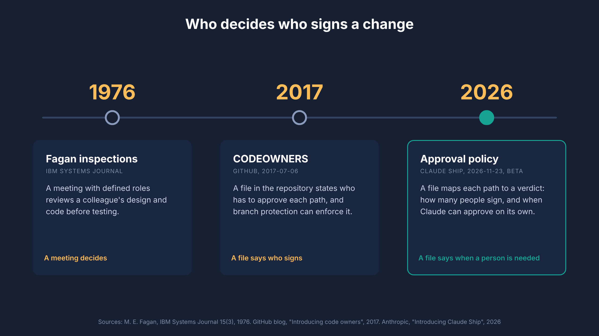
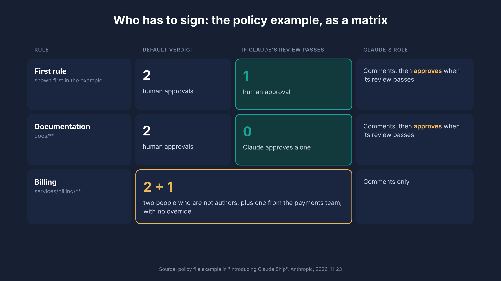

In most of the teams I know, approving a pull request has become a gesture more than a check, and the acronym LGTM, looks good to me, often ends up under changes nobody has read to the end, because the queue is long, the author is a trusted colleague and the tests are green. As long as people wrote the code this small hypocrisy was sustainable, since the pace of writing also limited the number of reviews to do, but with agents producing changes in a few minutes the volume grows and a human signature on every line stops being realistic. On 2026-11-23 Anthropic introduced Claude Ship in beta, which among other things lets Claude approve pull requests when the team's rules allow it, and I find it useful to look at it starting from a question older than the product, namely what a signature on a change is for.

##### From a meeting to a file

Code review as a formal process has a precise date of birth. In 1976 Michael Fagan published in the IBM Systems Journal the paper describing design and code inspections, meetings with defined roles in which a group of people examines a colleague's work before testing, with an economic motivation, because an error costs more the later it is found. With platforms such as GitHub the meeting became asynchronous and review moved inside the pull request, but the underlying idea stayed the same: at least one person other than the author has to look at the change. On 2017-07-06 GitHub introduced code owners, inspired by Chromium's OWNERS files, and for the first time a file in the repository stated who has to sign what, with branch protection able to block the merge until the owner of a folder has approved. It is a step that is usually underrated, because it turns a team habit into a versioned rule that can be read and reviewed like the rest of the code.

<figure>
  
  <figcaption>In fifty years the decision on who approves a change has moved from a meeting to a file that also describes when a person is not needed.</figcaption>
</figure>

##### The bottleneck has moved

Anthropic says that in the Claude Code team most of the code is now written by Claude, and already in the Scion story the company had explained that the limit is no longer writing but everything that comes after, from version control to the pipeline. Review is the slowest link in this chain, because it depends on people's time and attention, and faced with a growing volume there are two roads. You can keep asking for a human signature on everything, knowing it will more and more often become a rubber stamp, or you can decide explicitly where human attention is really needed and where an automated check can replace it. The second road seems more honest to me, provided the decision is written down instead of depending on the mood of whoever opens the queue on Monday morning.

##### Anthropic's proposal

Claude Ship combines Claude's Code Review, already available, with two agents in beta, one that fixes the pull request when checks fail or comments arrive and another, Claude Approvals, that decides whether the change can go through. What sets it apart from a review bot is the policy file the team writes in the repository, which Anthropic itself presents as a smarter CODEOWNERS, because besides stating who has to sign it maps each set of paths to a verdict. In the example published with the announcement, documentation can be approved by Claude alone if its review finds no problems, while billing code requires two people other than the authors, one of them from the payments team, and leaves Claude only the comment. Compared to 2017 the file goes one step further, because besides saying who has to sign it also says when a person is not needed.

<figure>
  
  <figcaption>The three rules of the policy example published by Anthropic, read as a matrix of path, Claude's role and required human sign-offs.</figcaption>
</figure>

##### Four eyes from the same model

The most serious objection concerns the four-eyes principle, which security standards call segregation of duties and which exists because two different people rarely make the same mistake in the same place. When Claude writes the code and Claude approves it this independence weakens, because two instances of the same model can share the same blind spots, and the fact that the agent in charge of fixes is designed not to approve or merge reduces the problem without removing it. The answer, in my view, lies in the file again, where the areas in which a mistake is expensive must stay under human signature, and the policy only works if whoever writes it has the courage to be strict exactly there. The most sensitive sectors stay out in any case, because the product is not available to organisations with Zero Data Retention, the HIPAA configuration or customer-managed encryption keys, it only works on GitHub repositories and it has a token cost that accrues even while the policy runs in observe-only mode.

##### Write the policy before choosing the tool

The advice I would give a team, whether it uses Claude Ship or not, is to write that policy anyway, listing the areas of the code, the cost of a mistake in each one and the number of signatures it deserves. Anthropic suggests starting in observe-only mode, where the verdict is published without blocking anything, and I would use that period to measure how often the agent's decision matches the people's, because that is the figure that tells you whether it can be trusted. It counts for more than the internal results Anthropic reports, with merged pull requests more than doubling between June and September and the share of reverts falling by more than 40%, which remain vendor numbers measured on the team that builds the tool. A well written approval policy forces a team to state which changes still deserve a person, and it is a choice many teams have been making implicitly for years, every time they approve a pull request without having read it.
