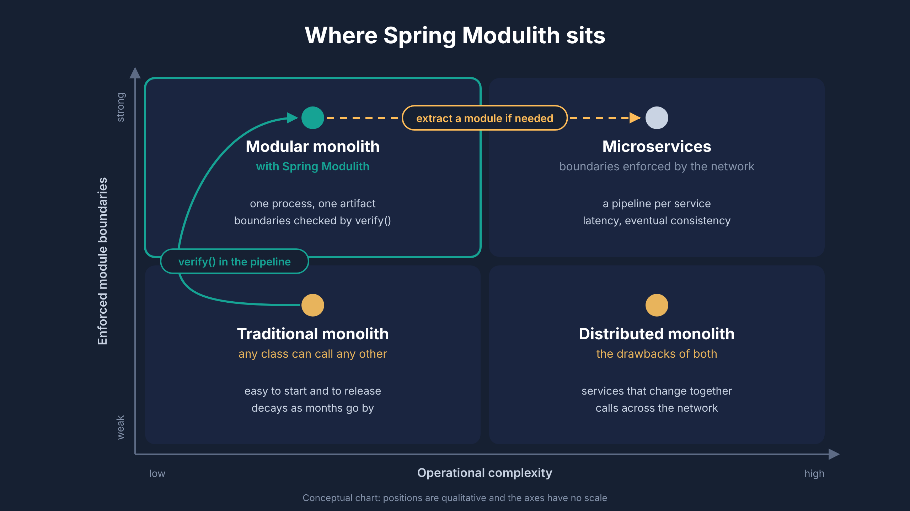

Per anni la discussione sull'architettura delle applicazioni Spring Boot si è ridotta a una scelta secca tra due estremi. Da una parte c'è il monolite tradizionale, semplice da sviluppare e da rilasciare ma destinato, con il passare dei mesi, a diventare un groviglio in cui ogni classe può chiamare qualunque altra, dall'altra ci sono i microservizi, che impongono confini netti al prezzo di una rete da attraversare, di una pipeline per ogni servizio e di un'intera disciplina operativa da gestire. Spring Modulith è la risposta ufficiale del progetto Spring a chi cerca qualcosa nel mezzo, cioè un toolkit che lascia l'applicazione in un unico processo e in un unico artefatto, ma organizza il codice in moduli logici ispirati al Domain-Driven Design e, soprattutto, controlla in modo automatico che quei confini vengano rispettati nel tempo.

##### Una via di mezzo con una storia lunga

Il problema del monolite non è il fatto di girare in un unico processo, ma il degrado strutturale che subisce quando nulla impedisce a un modulo di dipendere dai dettagli interni di un altro. Spostare tutto in servizi separati risolve questo degrado per costrizione, perché un servizio non può importare le classi di un altro, ma introduce latenza, consistenza eventuale e osservabilità distribuita anche quando il dominio non lo richiede, e nei casi peggiori produce un monolite distribuito che somma gli svantaggi di entrambe le soluzioni. Oliver Drotbohm, del team Spring, ha coltivato questa idea per anni come progetto di ricerca personale, che nel 2022 è diventato un progetto sperimentale di Spring e il 21 agosto 2023 ha raggiunto la versione 1.0 come progetto ufficiale. La versione 2.0, rilasciata a novembre 2025, ha spostato la base su Spring Boot 4 e Spring Framework 7, mentre la 2.1 è arrivata a giugno 2026.

<figure>
  
  <figcaption>Spring Modulith punta al quadrante con confini solidi e complessità operativa ancora bassa</figcaption>
</figure>

##### I moduli sono i package

La scelta più interessante di Spring Modulith è l'assenza quasi totale di configurazione, perché per impostazione predefinita ogni sotto-package diretto del package principale dell'applicazione viene considerato un modulo. I tipi pubblici che si trovano nella radice del modulo ne costituiscono l'interfaccia, mentre tutto ciò che sta nei sotto-package è considerato interno, anche quando Java costringe a dichiarare pubblica una classe perché un'altra classe dello stesso modulo possa usarla.

```text
com.example.shop
├── ShopApplication.java
├── order
│   ├── OrderManagement.java      // public API of the module
│   ├── OrderCompleted.java       // event published by the module
│   └── internal
│       └── OrderRepository.java  // hidden from other modules
└── inventory
    ├── InventoryManagement.java
    └── internal
        └── StockLevels.java
```

Quando un modulo deve esporre più di un package, per esempio un'interfaccia di estensione destinata ad altri moduli, basta annotare il relativo `package-info.java` con `@NamedInterface`, mentre `@ApplicationModule(allowedDependencies = …)` permette di dichiarare in modo esplicito da quali moduli un altro può dipendere. Il risultato è che l'architettura smette di vivere in un diagramma dimenticato su una wiki e diventa una proprietà della struttura del codice, leggibile da chiunque apra il progetto.

##### Confini verificati, non solo dichiarati

Una convenzione vale finché qualcuno la fa rispettare, e qui Spring Modulith offre il suo strumento più utile, un test di poche righe che costruisce il modello dei moduli a partire dalla classe principale e lo controlla.

```java
class ModularityTests {

    @Test
    void verifiesModularStructure() {
        ApplicationModules.of(ShopApplication.class).verify();
    }
}
```

Il metodo `verify()` fallisce se le dipendenze tra moduli formano un ciclo, se un modulo accede ai tipi interni di un altro o se vengono violate le dipendenze consentite dichiarate in modo esplicito, e quando nel classpath trova l'integrazione di jMolecules con ArchUnit applica anche le relative regole architetturali. Inserito nella pipeline di integrazione continua, trasforma ogni violazione dei confini in una build rossa invece che in una sorpresa scoperta mesi dopo durante un refactoring. Dalla versione 2.0 la stessa verifica può essere eseguita anche all'avvio dell'applicazione, aggiungendo l'artefatto `spring-modulith-runtime` e attivando la proprietà `spring.modulith.runtime.verification-enabled`.

##### Eventi al posto delle chiamate dirette

Anche con i confini rispettati, un modulo che invoca direttamente i servizi di altri cinque resta fortemente accoppiato, e per questo Spring Modulith suggerisce di integrare i moduli attraverso gli eventi applicativi di Spring. L'annotazione `@ApplicationModuleListener` è una scorciatoia che combina un listener transazionale eseguito dopo il commit con l'esecuzione asincrona e una nuova transazione dedicata.

```java
@Component
class InventoryManagement {

    @ApplicationModuleListener
    void on(OrderCompleted event) {
        // update stock levels in a separate transaction
    }
}
```

Il rischio di questo modello è perdere un evento se l'applicazione si ferma tra il commit dell'ordine e l'esecuzione del listener, ed è qui che interviene l'Event Publication Registry. Al momento della pubblicazione il registro scrive una voce per ogni listener interessato all'interno della stessa transazione di business, la segna come completata quando il listener termina con successo e la conserva in caso contrario, così che possa essere reinviata all'avvio successivo, se la proprietà dedicata è attiva, oppure da codice. Dalla 2.0 ogni pubblicazione ha un ciclo di vita esplicito, con stati come in elaborazione, fallita e reinviata, e un monitor opzionale marca come fallite le pubblicazioni rimaste bloccate troppo a lungo, che si possono poi reinviare tramite `FailedEventPublications`. Il registro può essere salvato con JDBC, JPA, MongoDB o Neo4j.

<figure>
  
  <figcaption>L'evento viene salvato nella stessa transazione dell'ordine, quindi non può andare perso se il listener fallisce</figcaption>
</figure>

##### Test per modulo e documentazione che non invecchia

Con l'annotazione `@ApplicationModuleTest` un test di integrazione avvia soltanto il modulo in cui si trova, nella modalità predefinita `STANDALONE`, oppure anche le sue dipendenze dirette o l'intero albero di dipendenze, il che riduce i tempi di avvio e rende evidente quando un modulo ha bisogno di troppi altri per funzionare. L'API `Scenario` permette poi di descrivere i test basati su eventi come uno stimolo seguito da un risultato atteso, per esempio la pubblicazione di un evento seguita da un cambiamento nello stato di un altro modulo. Lo stesso modello alimenta il `Documenter`, che genera diagrammi dei componenti in formato C4 e UML con PlantUML e un Application Module Canvas, cioè una tabella con i bean, gli aggregati, gli eventi pubblicati e ascoltati e le proprietà di configurazione di ogni modulo, che resta allineata al codice perché viene rigenerata a ogni build.

##### Quando conviene davvero

Spring Modulith non offre l'isolamento a runtime dei microservizi, perché i moduli condividono la stessa JVM, lo stesso classpath e spesso lo stesso database, quindi un errore di memoria in un modulo ferma tutta l'applicazione e la scalabilità resta quella dell'intero processo. In cambio offre qualcosa che per la maggior parte dei progetti conta di più, cioè la possibilità di rimandare la decisione sulla distribuzione fino a quando il dominio è stato capito davvero. Un modulo con confini verificati che comunica con gli altri soltanto tramite eventi è già il candidato ideale per diventare un servizio separato, e la sua estrazione diventa un lavoro di infrastruttura invece che uno scavo archeologico nel codice. Per un nuovo progetto Spring Boot, a questo punto, la domanda da porsi non è più se partire con un monolite o con i microservizi, ma se esiste una buona ragione per non partire con un monolite modulare.
