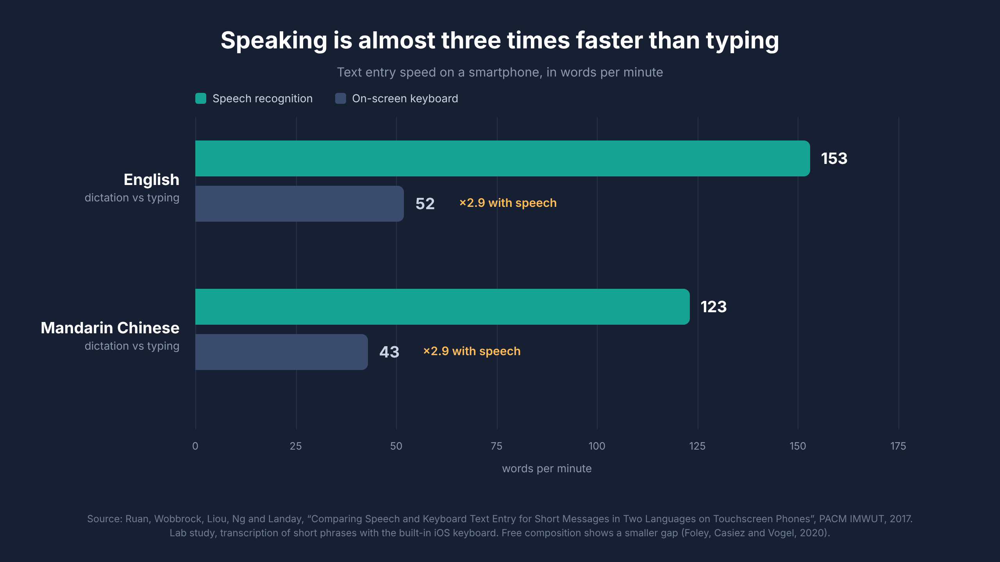
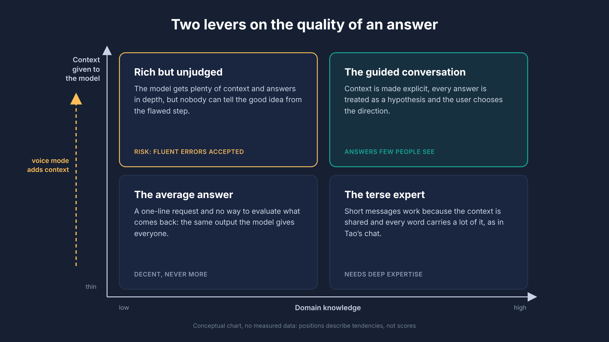

Chi non conosce un mestiere ottiene dall'intelligenza artificiale esattamente ciò che ottengono tutti gli altri. Fino a pochi anni fa chi non sapeva scrivere il codice di una pagina web chiedeva aiuto a un collega, oggi lo chiede a un modello e qualcosa di dignitoso viene fuori quasi sempre, e da questa esperienza nasce un'idea molto diffusa, secondo cui nel prompting non ci sarebbe alcuna competenza, perché parliamo tutti con la stessa macchina e un professionista otterrebbe lo stesso risultato di chi ha aperto ChatGPT per la prima volta stamattina. È un'idea comoda, ma non regge alla prova dei fatti, e il caso più istruttivo per capirlo arriva da uno dei matematici più premiati al mondo.

##### La conversazione di Terence Tao

Nell'estate del 2026 Terence Tao, medaglia Fields nel 2006 e professore alla UCLA, ha reso pubblica una sua conversazione con ChatGPT dedicata a un controesempio della congettura jacobiana, un problema di geometria algebrica aperto dal 1939, e per leggerla non serve seguire la matematica, perché la cosa interessante è la dinamica del dialogo. Tao scrive frasi brevissime, il modello risponde con tre paragrafi e lui replica soltanto al punto centrale, lasciando cadere il resto. Dopo pochi scambi il modello cambia registro, accorcia le risposte, smette di spiegare le cose da zero e comincia a parlare come parla un matematico, e quando una risposta non lo convince Tao si limita a osservare che la questione sembra più complicata di quanto sperasse, e la macchina si sposta. Il dettaglio più rivelatore riguarda però la direzione, perché il modello suggerisce le strade da percorrere e Tao, quasi sempre, va altrove. Lo stesso modello che usano tutti produce così risposte che la maggior parte delle persone non vedrà mai, semplicemente perché si adatta all'interlocutore che ha davanti.

##### Il metodo non si copia

Letta così sembra una tecnica che si impara in dieci minuti, fatta di frasi corte e di un percorso scelto in autonomia, ma chi prova a replicarla scopre in fretta che non funziona, perché la brevità di Tao non è una scelta stilistica bensì la conseguenza di ciò che sa. Dentro tre paragrafi di risposta lui riconosce al volo l'idea buona, vede subito il passaggio che non torna e sa quale strada vale la pena esplorare, mentre i trucchi di conversazione arrivano dopo, come effetto collaterale della competenza. Con il codice succede esattamente la stessa cosa. Uno sviluppatore che conosce il proprio sistema può dire alla macchina che una soluzione è troppo lunga, oppure chiederle se quella logica non esista già in un altro modulo, mentre chi il sistema non lo conosce consegna il compito e accetta quello che torna indietro. Anche in quel caso qualcosa di utile arriva, ed è giusto così, ma è la stessa cosa che il modello dà a tutti gli altri, ed è proprio questo il punto.

##### Il pensiero critico come interfaccia

La differenza tra i due atteggiamenti ha un nome preciso, ed è pensiero critico applicato all'output di una macchina. La ricerca sui fattori umani studia da decenni l'automation bias, la tendenza a fidarsi di un sistema automatico più di quanto le prove giustifichino, e la rassegna di Parasuraman e Manzey del 2010 mostra che colpisce anche gli esperti. I modelli linguistici aggiungono un'aggravante, perché producono testo fluente, ordinato e sicuro di sé, e già nel 1999 Reber e Schwarz hanno mostrato che un'affermazione facile da leggere viene giudicata più vera di una che costa fatica. In pratica pensare in modo critico con un modello significa trattare ogni risposta come un'ipotesi da verificare e non come una conclusione, chiedergli quali assunzioni sta facendo e in quali casi la sua soluzione smetterebbe di funzionare, cercare il controesempio invece della conferma e riservarsi sempre la scelta della direzione, come fa Tao quando ignora la strada suggerita. Nessuno di questi gesti richiede di essere un genio, ma tutti richiedono di sapere abbastanza da riconoscere un errore quando lo si ha davanti.

##### Parlare invece di scrivere

Esiste poi un secondo modo per cambiare la qualità delle risposte, più accessibile, che riguarda il canale con cui si comunica con il modello. La maggior parte delle persone usa l'AI come una chat e scrive richieste di una riga, perché scrivere costa fatica, ma una richiesta di una riga lascia al modello il compito di indovinare tutto il resto, dal contesto ai vincoli, dal livello di dettaglio allo scopo. La modalità vocale ribalta questo rapporto. Uno studio di Stanford e dell'Università di Washington, pubblicato nel 2017 da Ruan, Wobbrock, Landay e colleghi, ha misurato che sullo smartphone la dettatura in inglese raggiunge 153 parole al minuto contro le 52 della tastiera, quasi il triplo, con un rapporto simile in cinese mandarino. L'esperimento riguardava la trascrizione di frasi brevi e non la composizione libera, ma l'ordine di grandezza basta a spiegare l'effetto: parlando si dice molto di più a parità di tempo, e soprattutto si dice ciò che per iscritto verrebbe tagliato, come i dubbi, le alternative già scartate, il motivo per cui la soluzione ovvia non va bene o la storia del progetto che giustifica una scelta strana, cioè esattamente il materiale di cui il modello ha bisogno per smettere di produrre la risposta media.

<figure>
  
  <figcaption>Parlando si inserisce quasi il triplo del testo rispetto alla tastiera dello smartphone, secondo la misurazione di Ruan e colleghi</figcaption>
</figure>

##### Brevità e abbondanza sono la stessa lezione

Può sembrare una contraddizione rispetto alle frasi brevissime di Tao, ma è la stessa lezione vista da due lati. Tao può permettersi di essere conciso perché il contesto lo ha già in testa e ogni sua parola ne trasporta moltissimo, mentre chi conosce meno il dominio, o affronta un problema per la prima volta, ha bisogno di esplicitare ciò che sa per poterlo mettere sul tavolo. Parlare ad alta voce costringe anche a mettere in ordine il ragionamento, come con la paperella di gomma cara agli sviluppatori. Il rischio è il flusso di coscienza disordinato, e per questo conviene chiudere ogni monologo chiedendo al modello di riassumere ciò che ha capito e di indicare le domande ancora aperte prima di proporre qualsiasi soluzione. È un controllo di comprensione che riporta il pensiero critico dentro il dialogo, perché verifica che il modello abbia capito il problema giusto prima di valutarne la risposta.

<figure>
  
  <figcaption>La conoscenza del dominio permette di giudicare le risposte, il contesto esplicito permette al modello di darne di migliori</figcaption>
</figure>

##### Restiamo noi la parte lenta

Con modelli sempre più capaci la parte lenta del sistema non è più la macchina ma chi la interroga, perché le risposte buone sono in un certo senso già dentro il modello e serve qualcuno che conosca il mestiere per tirarle fuori, che si tratti di matematica, di architettura software o di diritto del lavoro. Per un team di sviluppo questo significa che la competenza di dominio non perde valore con l'arrivo dell'AI ma ne acquista, perché diventa il filtro che separa l'output medio da quello eccellente, e che formare le persone resta il modo più efficace per ottenere di più dagli strumenti che usano tutti. Il modello è lo stesso per chiunque, la conversazione no, e la differenza la fa ciò che ciascuno porta al tavolo.
