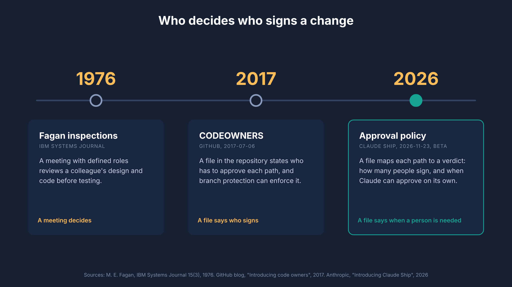
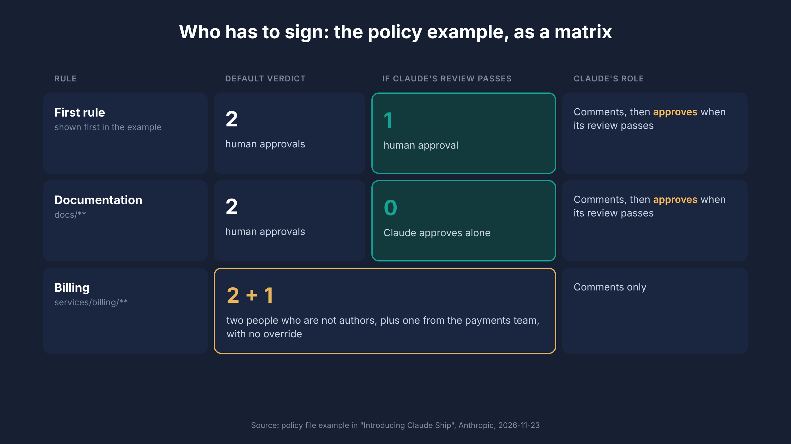

Nella maggior parte dei team che conosco l'approvazione di una pull request è diventata un gesto più che un controllo, e la sigla LGTM, looks good to me, finisce spesso sotto modifiche che nessuno ha letto fino in fondo, perché la coda è lunga, l'autore è un collega fidato e i test sono verdi. Finché il codice lo scrivevano le persone questa piccola ipocrisia restava sostenibile, dato che il ritmo di scrittura limitava anche il numero di revisioni da fare, ma con gli agenti che producono modifiche in pochi minuti il volume cresce e la firma umana su ogni riga smette di essere realistica. Il 2026-11-23 Anthropic ha presentato in beta Claude Ship, che tra le altre cose permette a Claude di approvare le pull request quando le regole del team lo consentono, e trovo utile guardarlo partendo da una domanda più vecchia del prodotto, cioè a cosa serve una firma su una modifica.

##### Da una riunione a un file

La revisione del codice come processo formale ha una data di nascita precisa. Nel 1976 Michael Fagan pubblica sull'IBM Systems Journal l'articolo che descrive le ispezioni di progetto e di codice, riunioni con ruoli definiti in cui un gruppo di persone esamina il lavoro di un collega prima dei test, con una motivazione economica, perché un errore costa tanto di più quanto più tardi viene scoperto. Con piattaforme come GitHub la riunione è diventata asincrona e la revisione si è spostata dentro la pull request, ma l'idea di fondo è rimasta la stessa: almeno una persona diversa dall'autore deve guardare la modifica. Il 2017-07-06 GitHub introduce i code owners, ispirati ai file OWNERS di Chromium, e per la prima volta un file nel repository stabilisce chi deve firmare cosa, con la branch protection che può bloccare il merge finché il proprietario di una cartella non ha approvato. È un passaggio che di solito si sottovaluta, perché trasforma una consuetudine del team in una regola versionata, che si legge e si rivede come il resto del codice.

<figure>
  
  <figcaption>In cinquant’anni la decisione su chi approva una modifica è passata da una riunione a un file che descrive anche quando una persona non serve.</figcaption>
</figure>

##### Il collo di bottiglia si è spostato

Anthropic racconta che nel team di Claude Code la maggior parte del codice la scrive ormai Claude, e già nel caso di Scion l'azienda aveva spiegato che il limite non è più la scrittura ma tutto ciò che viene dopo, dal controllo di versione alla pipeline. La revisione è l'anello più lento di questa catena, perché dipende dal tempo e dall'attenzione delle persone, e davanti a un volume che cresce le strade sono due. Si può continuare a chiedere una firma umana su tutto, sapendo che diventerà sempre più spesso un timbro, oppure decidere in modo esplicito dove l'attenzione umana serve davvero e dove può essere sostituita da un controllo automatico. A me sembra più onesta la seconda strada, a patto che la decisione venga messa per iscritto invece di dipendere dall'umore di chi apre la coda il lunedì mattina.

##### La proposta di Anthropic

Claude Ship mette insieme la Code Review di Claude, già disponibile, con due agenti in beta, uno che corregge la pull request quando falliscono i controlli o arrivano commenti e un altro, Claude Approvals, che decide se la modifica può passare. A distinguerlo da un bot di revisione è il file di policy che il team scrive nel repository, che Anthropic stessa presenta come un CODEOWNERS più intelligente, perché oltre a indicare chi deve firmare associa a ogni insieme di percorsi un verdetto. Nell'esempio pubblicato con l'annuncio la documentazione può essere approvata dal solo Claude se la sua revisione non trova problemi, mentre il codice della fatturazione richiede due persone diverse dagli autori, una delle quali del team pagamenti, e a Claude lascia soltanto il commento. Rispetto al 2017 il file fa un passo in più, perché oltre a dire chi deve firmare dice anche quando una persona non è necessaria.

<figure>
  
  <figcaption>Le tre regole dell’esempio di policy pubblicato da Anthropic, lette come una matrice tra percorso, ruolo di Claude e firme umane richieste.</figcaption>
</figure>

##### Quattro occhi dello stesso modello

L'obiezione più seria riguarda il principio dei quattro occhi, che le norme di sicurezza chiamano separazione dei compiti e che esiste perché due persone diverse difficilmente commettono lo stesso errore nello stesso punto. Quando il codice lo scrive Claude e lo approva Claude questa indipendenza si indebolisce, perché due istanze dello stesso modello possono condividere gli stessi punti ciechi, e il fatto che l'agente incaricato delle correzioni sia progettato per non approvare né fare merge riduce il problema senza eliminarlo. La risposta, secondo me, sta di nuovo nel file, dove le aree in cui un errore costa caro devono restare a firma umana, e la policy funziona solo se chi la scrive ha il coraggio di essere severo proprio lì. I settori più sensibili, del resto, restano fuori in ogni caso, perché il prodotto non è disponibile per le organizzazioni con Zero Data Retention, con la configurazione HIPAA o con chiavi di cifratura gestite dal cliente, lavora soltanto su repository GitHub e ha un costo a token che matura anche quando la policy gira in sola osservazione.

##### Scrivere la policy prima di scegliere lo strumento

Il consiglio che darei a un team, che usi Claude Ship o no, è di scrivere comunque quella policy, elencando le aree del codice, il costo di un errore in ciascuna e il numero di firme che merita. Anthropic suggerisce di partire in modalità di sola osservazione, in cui il verdetto viene pubblicato senza bloccare nulla, e io userei quel periodo per misurare quante volte la decisione dell'agente coincide con quella delle persone, perché è il dato che dice se ci si può fidare. Conta più dei risultati interni riportati da Anthropic, con le pull request mergiate più che raddoppiate tra giugno e settembre e la quota di revert scesa di oltre il 40%, che restano numeri del produttore misurati sul team che costruisce lo strumento. Una policy di approvazione scritta bene obbliga a dichiarare quali modifiche meritano ancora una persona, ed è una scelta che molti team fanno già da anni in modo implicito, ogni volta che approvano una pull request senza averla letta.
